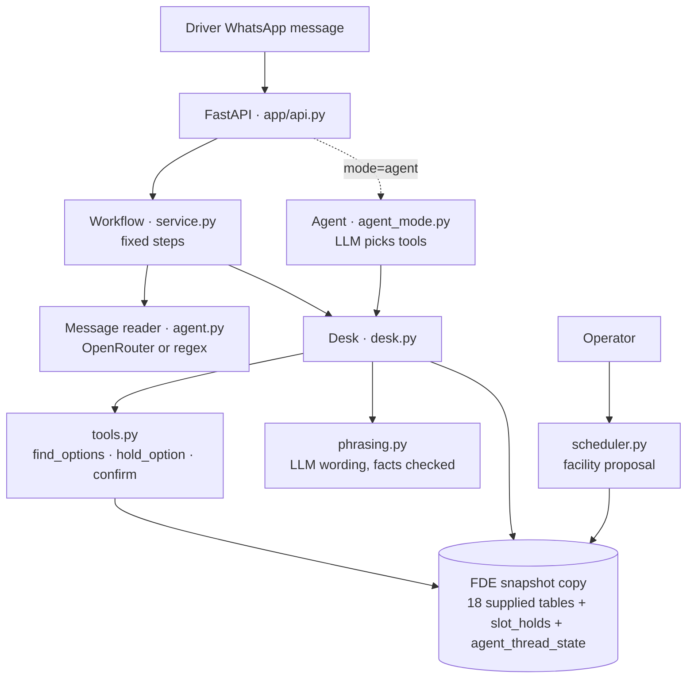

# Architecture

The LLM only reads text, words replies, and (in agent mode) chooses tools. Every capacity
change goes through `tools.py`, inside `BEGIN IMMEDIATE`, with the supplied
`ux_active_appointment_per_slot` index as the final guard.

## One message, end to end (workflow)

1. **Driver:** phone → `drivers`. Unknown number → stop.
2. **Thread:** `chat_threads` row (`CHAT-<conversation>`); state in `agent_thread_state`.
3. **Duplicate?** Same external id, or same text within 3 min → log with `is_duplicate = 1`, stop.
4. **Read:** extractor → intent, ETA or delay, window, choice, confidence, reason, reference.
   Log to `chat_messages`.
5. **Shipment:** one open / named / only trip underway → else ask with order numbers (park the message).
6. **Cancelled** → tell the driver. **In dock** → status. **In the yard** → keep the slot if
   valid, else re-slot from now.
7. **Delay:** ETA = stated time, or current ETA (as of now) + delay → `eta_updates`,
   `shipments.latest_eta_ts`, `driver_exceptions`.
8. **Offer:** `find_options` → `hold_option` × up to 3 (main + extension) → reply. Nothing fits
   → escalate (`operational_messages` to a real contact).
9. **Confirm:** `confirm` (holds valid → old booking `CANCELLED` → new `CONFIRMED` → extension
   `BLOCKED`) → after commit, WhatsApp confirmation + warehouse notice.
10. **Reply:** LLM wording if configured and `phrasing.check` passes, else template → `chat_messages`.

## What `find_options` checks

| Rule | Source |
|---|---|
| Destination facility, active dock | `shipments`, `docks.dock_status` |
| Reefer → D5 (refrigerated reefer dock) | `required_dock_type`, `temperature_control_required`, RULE003 |
| > 25 t or HEAVY → D6 | `load_weight_kg`, RULE004 |
| Load ≤ dock max weight | `docks.max_vehicle_weight_kg` |
| Slot `OPEN`, no overlapping active booking on the dock | `appointment_slots`, `appointments` |
| No breakdown / maintenance / manual block | `dock_status_events` |
| No live hold by another driver | `slot_holds` |
| Start ≥ now, ≤ last new start; end ≤ close | `facility_rules` RULE005, `facilities` |
| Unload fits, or next slot free as extension | `expected_unload_min` |
| Finish ≤ driver's limit | message |

## Tables written

| Table | When |
|---|---|
| `chat_threads`, `chat_messages` | every message, both directions |
| `eta_updates`, `shipments.latest_eta_ts` | delay reported |
| `driver_exceptions` | delay / ambiguity / escalation (one row per thread) |
| `slot_holds` (added) | options offered |
| `appointments` | confirm: old row cancelled, new row with `replaced_appointment_id` |
| `appointment_slots` | extension slot blocked / released |
| `operational_messages` | WhatsApp confirmation, warehouse notice, escalation |
| `agent_thread_state` (added) | offered options, parked message |
