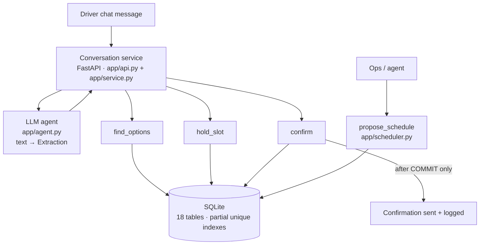
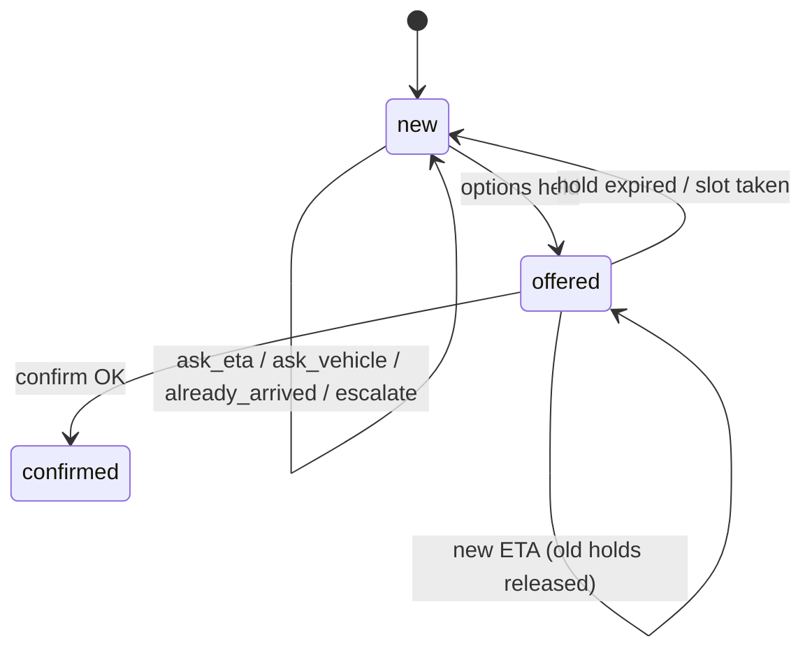

# Architecture



The agent only reads text. The tools only read structured data. Only the
tools write capacity, and only inside transactions.

## One message, end to end

1. Log the inbound message (`messages`).
2. Work out the shipment from the phone. If several match, ask for the truck number.
3. Extract fields from the text (LLM or regex) → validated `Extraction`.
4. If the gate shows the truck inside → "already arrived", stop.
5. Compute the new ETA (ops override > newest source) and record it (`eta_updates`).
6. `find_options` → `hold_slot` up to 3 → reply with options (state `offered`).
7. Driver picks one → `confirm` (one transaction) → after commit, send and log
   the confirmation, release the other holds.
8. Any failure → honest reply + fresh search or escalate. Never a false promise.

## Conversation states



## Tables (18, three groups)

| Group | Tables |
|---|---|
| Master data | facilities, docks, carriers, drivers, vehicles, customers |
| Plan and operations | shipments, slots, dock_blocks, appointments, appointment_history, eta_updates, gate_events, dock_events |
| Conversations and messaging | conversations, messages, outbound_confirmations, slot_holds |

Integrity rules in the database:
- `ux_appt_slot_active`: one active appointment per slot (supplied by the brief)
- `ux_appt_shipment_active`: one active appointment per shipment (supplied by the brief)
- `ux_hold_slot_active`: one active hold per slot (added)

## Concurrency, in one picture

```
Driver A chat ─┐                    ┌─ hold_slot(S) → INSERT hold … OK
               ├─ both see S free ──┤
Driver B chat ─┘                    └─ hold_slot(S) → unique index → slot_held → B gets other options
```
Even with holds bypassed (`book_direct`), the appointment unique index lets
exactly one insert through. Tested with 10 threads released by a barrier.
